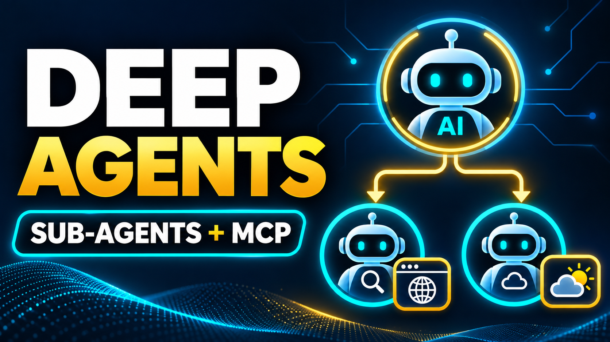
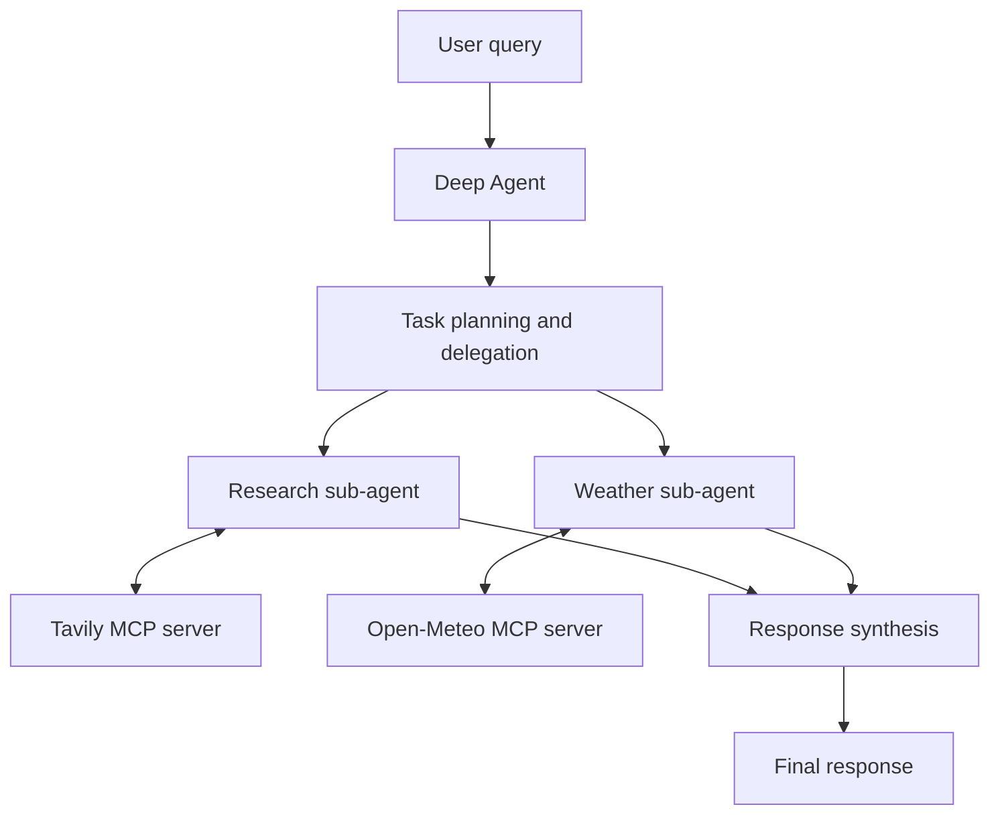

# Build a Deep Agent with Specialized Sub-Agents
[YouTube Video Lecture on Concept](https://youtu.be/pW93YApJUKw?si=v8c-sM3wirG3tF3P)

[Youtube Video Lecture on Coding Demo](https://youtu.be/YgYsKqVbe0s?si=9rHF_nQk7OqgWw2U)



Learn how to build an orchestrating **Deep Agent** using LangChain's Deep Agents library and the **Model Context Protocol (MCP)**. The agent delegates research and weather tasks to dedicated specialists, then combines their findings into a single response.

## What you will learn

- Compare standard LangChain agents with Deep Agents.
- Create specialized sub-agents with their own instructions and tools.
- Connect to MCP servers over Streamable HTTP.
- Discover tools concurrently using `asyncio.gather()`.
- Delegate tasks using `create_deep_agent()` and synthesize specialist responses.
- Invoke the agent asynchronously with natural-language queries.

## Architecture



| Component | Responsibility |
|---|---|
| Deep Agent | Understand the request, plan, delegate and synthesize |
| Research sub-agent | Search public information and return relevant sources |
| Weather sub-agent | Retrieve forecasts for specified locations and dates |
| Tavily MCP | Provide web search tools |
| Open-Meteo MCP | Provide weather information through a compatible MCP endpoint |

## Prerequisites

- Python 3.13 and [uv](https://docs.astral.sh/uv/)
- An OpenAI API key (or a compatible model configured for Deep Agents)
- A [Tavily API key](https://app.tavily.com/)
- An accessible Open-Meteo-compatible MCP server that exposes forecast tools

## Environment setup

From the repository directory:

```bash
uv venv --python 3.13
uv pip install deepagents langchain-openai langchain-mcp-adapters python-dotenv
```

Create a local `.env` file:

```dotenv
OPENAI_API_KEY=your_openai_api_key
TAVILY_API_KEY=your_tavily_api_key
AGENT_MODEL=openai:gpt-5.4-mini
WEATHER_MCP_URL=your_weather_mcp_endpoint
```

Set `WEATHER_MCP_URL` to a compatible endpoint that supports the MCP Streamable HTTP transport and weather forecasts. A regular weather REST API URL alone is not an MCP endpoint. Use a model available to your account.

Add `.env` and `.venv/` to `.gitignore` before committing.

## Implementation

The following example can be saved as `agent.py`.

```python
import asyncio
import os

from dotenv import load_dotenv
from deepagents import create_deep_agent
from langchain_mcp_adapters.client import MultiServerMCPClient


async def main():
    load_dotenv()

    model = os.getenv("AGENT_MODEL", "openai:gpt-5.4-mini")

    client = MultiServerMCPClient({
        "tavily": {
            "transport": "streamable_http",
            "url": "https://mcp.tavily.com/mcp/",
            "headers": {
                "Authorization": f"Bearer {os.environ['TAVILY_API_KEY']}"
            },
        },
        "open_meteo": {
            "transport": "streamable_http",
            "url": os.environ["WEATHER_MCP_URL"],
        },
    })

    # Discover the two sets of MCP tools concurrently.
    tavily_tools, weather_tools = await asyncio.gather(
        client.get_tools(server_name="tavily"),
        client.get_tools(server_name="open_meteo"),
    )

    research_agent = {
        "name": "research-agent",
        "description": "Research public information and attractions.",
        "system_prompt": (
            "Use web search to find relevant public sources. "
            "Return concise findings and source URLs."
        ),
        "tools": tavily_tools,
    }

    weather_agent = {
        "name": "weather-agent",
        "description": "Retrieve weather information and forecasts.",
        "system_prompt": (
            "Use weather tools to retrieve forecasts. "
            "Report the location, dates, units and limitations accurately."
        ),
        "tools": weather_tools,
    }

    agent = create_deep_agent(
        model=model,
        subagents=[research_agent, weather_agent],
        system_prompt=(
            "Delegate research and weather tasks to the appropriate specialists. "
            "Combine their findings into one response, cite sources, "
            "and do not invent missing forecasts."
        ),
    )

    while True:
        try:
            query = input("User: ").strip()
        except EOFError:
            break

        if query.lower() in {"quit", "exit"}:
            break
        if not query:
            continue

        result = await agent.ainvoke({
            "messages": [{"role": "user", "content": query}]
        })
        print("Assistant:", result["messages"][-1].content)


if __name__ == "__main__":
    asyncio.run(main())
```

Run the example:

```bash
uv run --no-project python agent.py
```

## Example queries

| Query | Expected specialist |
|---|---|
| What are the most popular attractions in Chicago? | Research |
| What is the weather forecast for Chicago this weekend? | Weather |
| Find popular tourist attractions in Chicago and check the weather forecast for this weekend. | Both |

For the combined query, the orchestrating agent delegates the research and weather subtasks, receives the specialist findings and generates weather-aware recommendations. Actual results depend on the available tools and live data. Type `quit` to exit. Each request is independent in this example; persistent conversational memory is not configured.

## Key concepts

| Concept | Meaning |
|---|---|
| Deep Agent | An agent with built-in capabilities such as planning, delegation and context management |
| Sub-agent | A specialist with a focused task, instructions, tools and separate execution context |
| `description` | Helps the parent decide when to delegate to a specialist |
| `system_prompt` | Defines an agent's responsibilities and behavior |
| `asyncio.gather()` | Runs independent awaitables concurrently and returns results in argument order |
| `await agent.ainvoke()` | Asynchronously executes the agent workflow and waits for its result |

Concurrent tool discovery does not guarantee that all delegated subtasks run simultaneously; execution depends on the agent's decisions.

### MCP transport comparison

| Feature | stdio | Streamable HTTP |
|---|---|---|
| Communication | Standard input/output | HTTP |
| Server execution | Usually a local subprocess | Local or remote service |
| Hosted server installation | Not applicable | No local server installation |
| Dependencies | Typically installed locally | Managed by the remote provider |
| Network | Not required by the transport itself | Required for remote endpoints |


## References

- [LangChain Deep Agents documentation](https://docs.langchain.com/oss/python/deepagents/overview)
- [LangChain MCP integration](https://docs.langchain.com/oss/python/langchain/mcp)
- [Model Context Protocol](https://modelcontextprotocol.io/)
- [Tavily MCP](https://github.com/tavily-ai/tavily-mcp)
- [Open-Meteo](https://open-meteo.com/)
- [Python asyncio.gather](https://docs.python.org/3/library/asyncio-task.html#asyncio.gather)
- [uv documentation](https://docs.astral.sh/uv/)

---

Part of the **LLMs & Agentic AI** lecture series.
